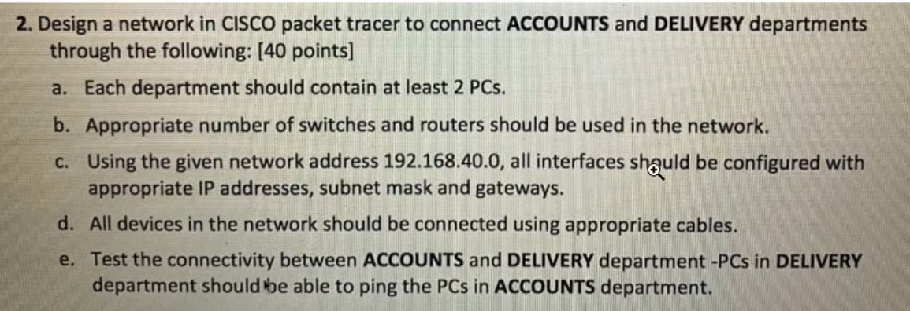
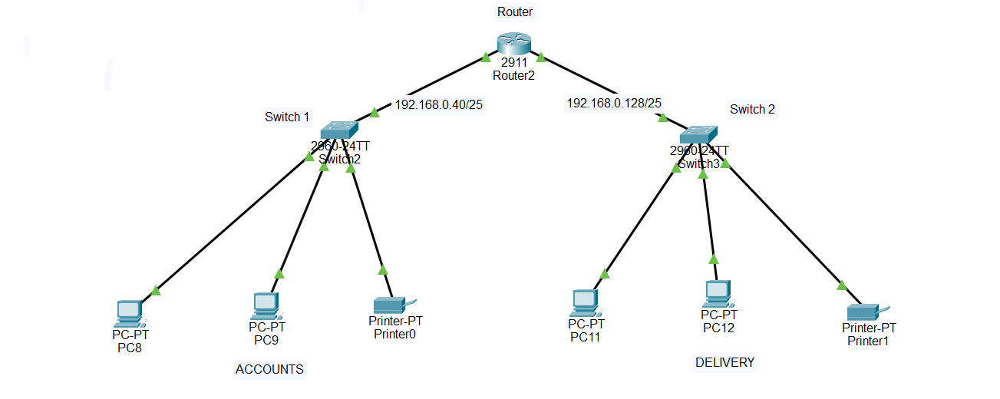

# **LAB 1** ~ Inter-Department Network Design Using Cisco Packet Tracer

## 📌 Project Overview

This project demonstrates the design and implementation of a small organizational network using **Cisco Packet Tracer**.

The network connects two departments:

- **Accounts Department**
- **Delivery Department**

Both departments are connected through a central **Cisco 2911 Router**, with a dedicated **Cisco 2960 Switch** for each department.

The main objective is to establish communication between the two departments and verify connectivity using the ICMP `ping` command.

## Scenario



## 🎯 Project Objectives

- Design a network connecting two departments.
- Configure appropriate routers and switches.
- Assign IP addresses and subnet masks using the given network address `192.168.40.0`.
- Configure default gateways for all end devices.
- Establish communication between different subnets.
- Test connectivity between Accounts and Delivery department PCs.

## 🖥️ Network Topology

The network consists of the following devices:

| Device | Quantity |
|---|---:|
| Cisco 2911 Router | 1 |
| Cisco 2960 Switch | 2 |
| PCs | 4 |
| Printers | 2 |

Each department has two PCs and one printer connected to its respective switch.

The two switches are connected to the central router, enabling communication between both departments.

## 🌐 IP Addressing Scheme

The given network `192.168.40.0/24` is divided into two subnets using a `/25` subnet mask.

### 1. Accounts Department

**Network Address:** `192.168.40.0/25`

| Device | IP Address | Subnet Mask | Default Gateway |
|---|---|---|---|
| Router G0/0 | 192.168.40.1 | 255.255.255.128 | N/A |
| PC1 | 192.168.40.10 | 255.255.255.128 | 192.168.40.1 |
| PC2 | 192.168.40.11 | 255.255.255.128 | 192.168.40.1 |
| Printer | 192.168.40.20 | 255.255.255.128 | 192.168.40.1 |

### 2. Delivery Department

**Network Address:** `192.168.40.128/25`

| Device | IP Address | Subnet Mask | Default Gateway |
|---|---|---|---|
| Router G0/1 | 192.168.40.129 | 255.255.255.128 | N/A |
| PC1 | 192.168.40.130 | 255.255.255.128 | 192.168.40.129 |
| PC2 | 192.168.40.131 | 255.255.255.128 | 192.168.40.129 |
| Printer | 192.168.40.140 | 255.255.255.128 | 192.168.40.129 |

## 🔌 Network Configuration

### 1. Router Configuration

The router interfaces are configured with the gateway IP addresses for both departments.

```bash
enable
configure terminal

interface gigabitEthernet 0/0
ip address 192.168.40.1 255.255.255.128
no shutdown
exit

interface gigabitEthernet 0/1
ip address 192.168.40.129 255.255.255.128
no shutdown
exit

end
write memory
```

### 2. Switch Configuration

Both Cisco 2960 switches are connected to the router and their respective end devices.

The default switch configuration is sufficient for this basic network because each department uses a separate physical switch.

### 3. PC Configuration

Each PC is configured with the following network settings:

- IP Address
- Subnet Mask
- Default Gateway

These settings are configured through:

**Desktop → IP Configuration** in Cisco Packet Tracer.

## 🔗 Cable Connections

The following cable connections are used:

| Connection | Cable Type |
|---|---|
| PC to Switch | Copper Straight-Through |
| Printer to Switch | Copper Straight-Through |
| Switch to Router | Copper Straight-Through |

## 🧪 Connectivity Testing

Connectivity is tested using the `ping` command from the Command Prompt of the PCs.

### 1. Testing from Accounts Department

From an Accounts PC, execute:

```bash
ping 192.168.40.130
```

This tests connectivity with a PC in the Delivery Department.

### 2. Testing from Delivery Department

From a Delivery PC, execute:

```bash
ping 192.168.40.10
```

This tests connectivity with a PC in the Accounts Department.

## 🖥️ Final Network Topology



**Result:** Successful ping responses had been received, confirming communication between both departments.

## 🛠️ Tools and Technologies Used

- Cisco Packet Tracer
- Cisco 2911 Router
- Cisco 2960 Switches
- IPv4 Addressing
- Subnetting (`/25`)
- ICMP (Ping)
- Basic Router Configuration

## 📚 Key Learning Outcomes

Through this project, I gained practical experience in:

- Designing a basic organizational network.
- Understanding network topology.
- Configuring routers and switches.
- Implementing IPv4 addressing and subnetting.
- Configuring default gateways.
- Connecting multiple LANs through a router.
- Troubleshooting network connectivity using `ping`.

## 👨‍💻 Developer - Akhilesh Yadav

Created as a practical computer networking project using **Cisco Packet Tracer**.
